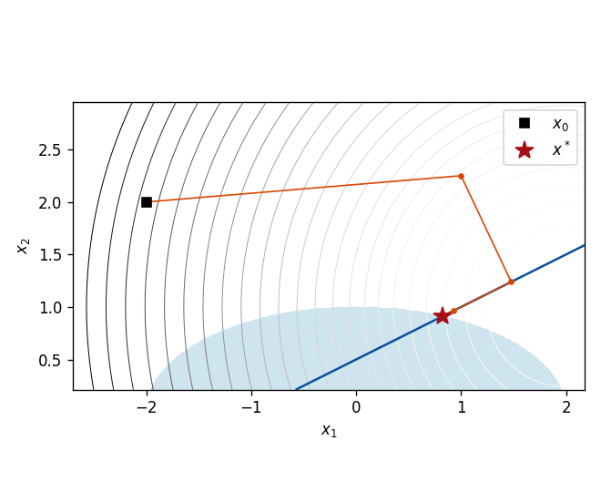
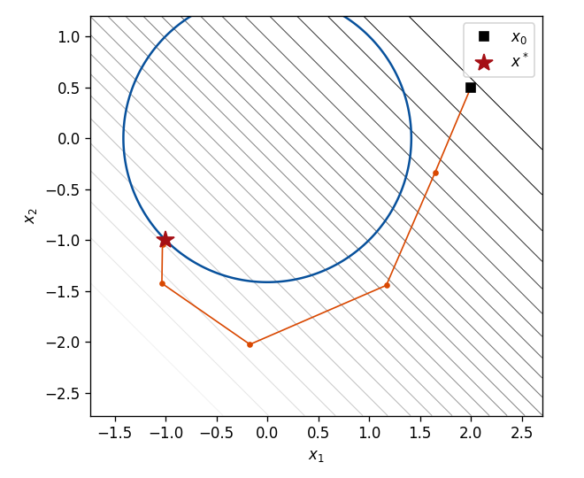
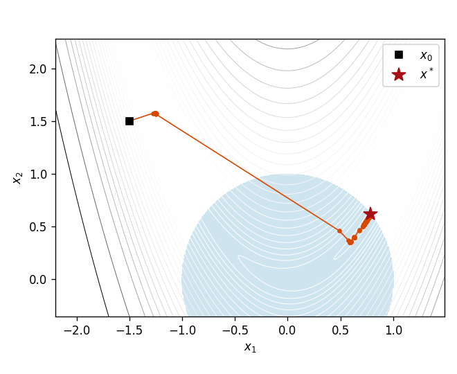
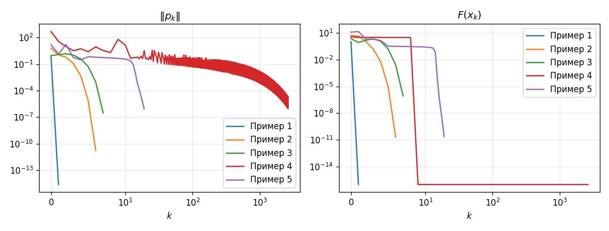

# Метод линеаризации

Реализация метода линеаризации Б. Н. Пшеничного для задачи нелинейного программирования
на Python (NumPy, SciPy). Практикум на ЭВМ, ВМК МГУ, кафедра исследования операций.

📄 **Отчёт:** [report.pdf](report.pdf): постановка задачи, обоснование сходимости, эксперименты, листинги.

## Задача

```
f(x) -> min,   g_i(x) <= 0, i = 1..m,   g_i(x) = 0, i = m+1..s,   x ∈ R^n
```

Функции гладкие, выпуклость не предполагается, начальная точка может быть недопустимой.

## Идея метода

На каждой итерации в точке `x_k`:

1. Ограничения и целевая функция заменяются линейными частями, и решается
   вспомогательная задача квадратичного программирования
   ```
   <f'(x_k), p> + |p|^2 / 2 -> min
   g_i(x_k) + <g_i'(x_k), p> <= 0   (для δ-активных неравенств)
   g_i(x_k) + <g_i'(x_k), p>  = 0   (для равенств)
   ```
   Её решение `p_k` задаёт направление движения. Задача сводится к поиску ближайшей
   к нулю точки многогранника и решается через NNLS (алгоритм Лоусона — Хенсона,
   `scipy.optimize.nnls`). Заодно получаются множители Лагранжа.
2. Шаг `α` выбирается дроблением так, чтобы уменьшалась функция точного штрафа
   `Φ_N(x) = f(x) + N·F(x)`, где `F(x)` — максимальное нарушение ограничений.
3. Если множители больше `N`, параметр штрафа увеличивается.
4. Остановка, когда `|p_k| ≤ τ` и `F(x_k) ≤ τ`.

## Структура

| Файл | Содержание |
|------|------------|
| [`linearization.py`](linearization.py) | сам метод: функция `linearization(problem, x0, ...)` |
| [`problems.py`](problems.py) | тестовые задачи |
| [`experiments.py`](experiments.py) | запуск на тестовых задачах, сравнение со SciPy, графики |
| [`figures/`](figures) | графики траекторий и сходимости |
| [`report.pdf`](report.pdf) | отчёт |

## Запуск

```bash
pip install -r requirements.txt
python experiments.py
```

Скрипт решает каждую задачу методом линеаризации и библиотечной функцией
`scipy.optimize.minimize` (SLSQP), печатает обе точки и пишет «совпадает», если они
отличаются меньше чем на `1e-5`. Затем выводит таблицы влияния параметров `δ` и `N`
и сохраняет графики в `figures/`.

Пример использования на своей задаче:

```python
import numpy as np
from linearization import Problem, linearization

# x1^2 + x2^2 -> min,  1 - x1 - x2 <= 0
problem = Problem(
    f=lambda x: x[0] ** 2 + x[1] ** 2,
    grad_f=lambda x: 2 * x,
    g=lambda x: np.array([1 - x[0] - x[1]]),
    jac_g=lambda x: np.array([[-1.0, -1.0]]),
    m=1,  # число неравенств; остальные ограничения считаются равенствами
)
res = linearization(problem, x0=[0.0, 0.0])
print(res.x, res.lam)  # [0.5 0.5] [1.]
```

## Результаты

Сравнение с `scipy.optimize.minimize` (SLSQP), точность `τ = 1e-6`:

| № | Задача | Итераций | f (наш метод) | f (SLSQP) | ‖x − x_SLSQP‖ |
|---|--------|---------:|--------------:|----------:|--------------:|
| 1 | квадратичная, линейное неравенство | 1 | 0.500000 | 0.500000 | 4·10⁻¹⁶ |
| 2 | эллипс и прямая (неравенство + равенство) | 6 | 1.393465 | 1.393465 | 2·10⁻¹¹ |
| 3 | окружность (невыпуклое множество) | 7 | −2.000000 | −2.000000 | 3·10⁻⁷ |
| 4 | функция Розенброка в круге | 2659 | 0.045675 | 0.045675 | 2·10⁻⁹ |
| 5 | HS71 (Хок — Шиттковски), n = 4 | 19 | 17.014017 | 17.014017 | 7·10⁻⁷ |

Траектории метода (примеры 2, 3, 4):

<p>
  
  
  
</p>

Сходимость `|p_k|` и `F(x_k)`:



Метод первого порядка: на хорошо обусловленных задачах сходится за несколько итераций,
на овражной функции Розенброка — медленно. Подробности в [отчёте](report.pdf).
